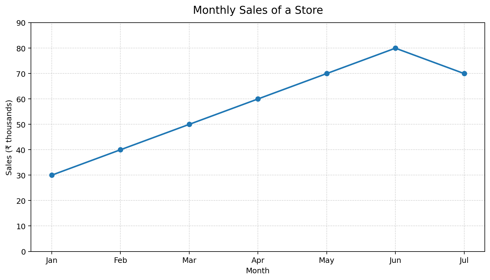
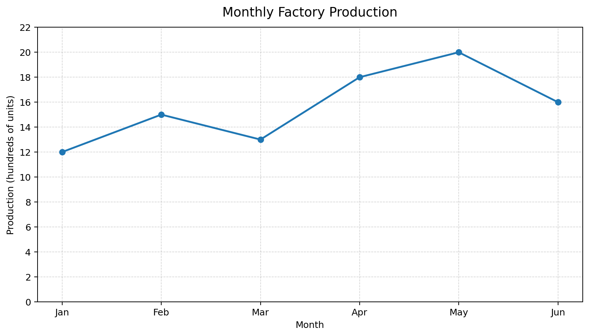
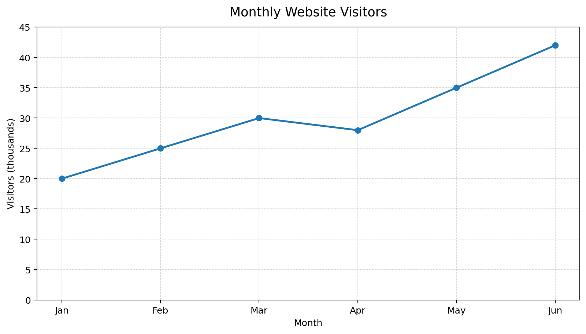
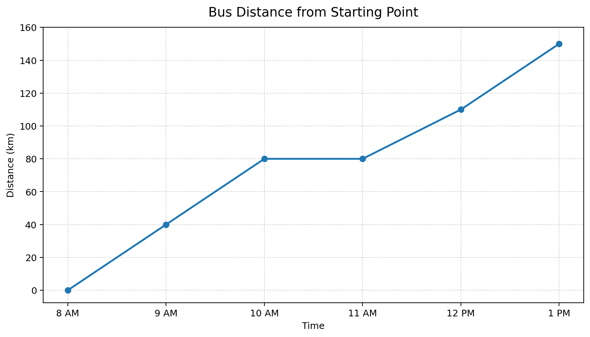
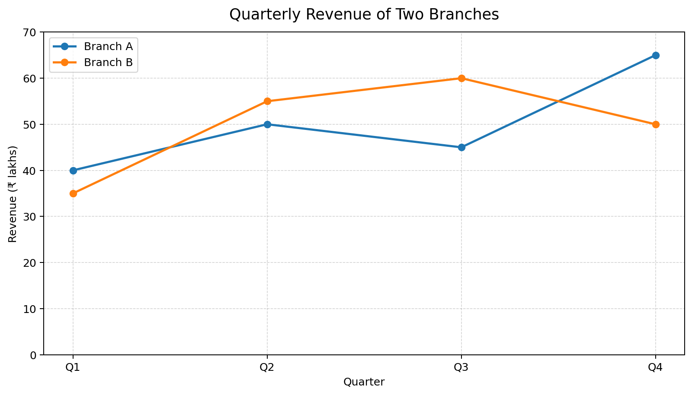
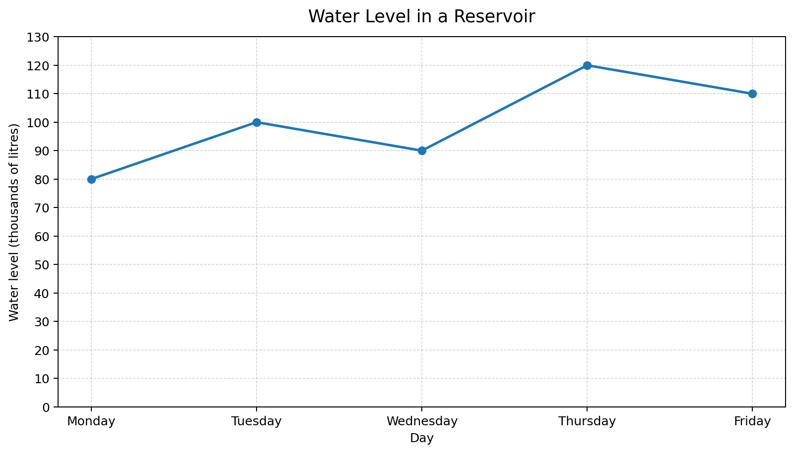

## Graph 1 — Monthly Store Sales

Values are in **₹ thousands**.

**Q1.** What were sales in March?

a) ₹40,000  
b) ₹50,000  
c) ₹60,000  
d) ₹70,000

**Q2.** Between which consecutive months did sales decrease?

a) Jan–Feb  
b) Feb–Mar  
c) May–Jun  
d) Jun–Jul

**Q3.** What were total sales from January to April?

a) ₹1,60,000  
b) ₹1,70,000  
c) ₹1,80,000  
d) ₹1,90,000

**Q4.** What was the average monthly sales over all seven months?

a) ₹50,000  
b) ₹55,000  
c) About ₹57,143  
d) ₹60,000

**Q5.** By what percentage did sales increase from January to June?

a) 150%  
b) 166⅔%  
c) 180%  
d) 200%

---

## Graph 2 — Factory Production

Production is in **hundreds of units**.

**Q6.** How many units were produced in April?

a) 1,600  
b) 1,800  
c) 2,000  
d) 2,200

**Q7.** What was the difference between the highest and lowest monthly production?

a) 600 units  
b) 700 units  
c) 800 units  
d) 900 units

**Q8.** What was total production from January to March?

a) 3,800 units  
b) 4,000 units  
c) 4,200 units  
d) 4,500 units

**Q9.** What was the ratio of February production to June production?

a) 15 : 16  
b) 16 : 15  
c) 15 : 13  
d) 13 : 15

**Q10.** By what percentage did production decrease from May to June?

a) 15%  
b) 20%  
c) 25%  
d) 30%

---

## Graph 3 — Website Visitors

Visitors are in **thousands**.

**Q11.** How many visitors came in June?

a) 35,000  
b) 38,000  
c) 40,000  
d) 42,000

**Q12.** In which month did visitors decrease compared with the previous month?

a) February  
b) March  
c) April  
d) May

**Q13.** What was the total number of visitors in January, February and March?

a) 70,000  
b) 75,000  
c) 80,000  
d) 85,000

**Q14.** What was the percentage increase in visitors from April to June?

a) 40%  
b) 45%  
c) 50%  
d) 55%

**Q15.** What was the average number of visitors per month over these six months?

a) 28,000  
b) 30,000  
c) 31,000  
d) 32,000

---

## Graph 4 — Bus Distance from Starting Point

Distance is in **kilometres**.

**Q16.** How far was the bus from its starting point at 10 AM?

a) 40 km  
b) 60 km  
c) 80 km  
d) 100 km

**Q17.** During which interval was the bus stationary?

a) 8–9 AM  
b) 9–10 AM  
c) 10–11 AM  
d) 11 AM–12 PM

**Q18.** How far did the bus travel between 11 AM and 1 PM?

a) 30 km  
b) 40 km  
c) 60 km  
d) 70 km

**Q19.** What was its average speed from 8 AM to 1 PM?

a) 25 km/h  
b) 30 km/h  
c) 35 km/h  
d) 40 km/h

**Q20.** If it continued at the same speed as between 11 AM and noon, how far would it travel in the next 2 hours?

a) 40 km  
b) 50 km  
c) 60 km  
d) 80 km

---

# Tricky Questions (10)

## Graph 5 — Quarterly Revenue of Two Branches

Revenue is in **₹ lakhs**.

**Q21.** What was Branch A's total annual revenue?

a) ₹190 lakh  
b) ₹195 lakh  
c) ₹200 lakh  
d) ₹205 lakh

**Q22.** In which quarter was the combined revenue highest?

a) Q1  
b) Q2  
c) Q3  
d) Q4

**Q23.** What was the difference between the branches' annual revenues?

a) ₹0 lakh  
b) ₹5 lakh  
c) ₹10 lakh  
d) ₹15 lakh

**Q24.** By what percentage did Branch A's revenue increase from Q3 to Q4?

a) 40%  
b) 44.4%  
c) 45%  
d) 50%

**Q25.** What percentage of the combined annual revenue came from Branch B?

a) 45%  
b) 47.5%  
c) 50%  
d) 52.5%

---

## Graph 6 — Reservoir Water Level

Water level is in **thousands of litres**.

**Q26.** On which day was the water level highest?

a) Tuesday  
b) Wednesday  
c) Thursday  
d) Friday

**Q27.** What was the net increase from Monday to Friday?

a) 20,000 litres  
b) 25,000 litres  
c) 30,000 litres  
d) 35,000 litres

**Q28.** What was the percentage decrease from Tuesday to Wednesday?

a) 5%  
b) 10%  
c) 12.5%  
d) 15%

**Q29.** What was the average water level across the five days?

a) 95,000 litres  
b) 100,000 litres  
c) 105,000 litres  
d) 110,000 litres

**Q30.** After Friday, 10,000 litres are added. How much higher is the new level than Monday's level, as a percentage of Monday's level?

a) 37.5%  
b) 40%  
c) 50%  
d) 62.5%

---

# Answer Key with Explanations

1. **b) ₹50,000** 
2. **d) Jun–Jul** 
3. **c) ₹1,80,000**
4. **c) About ₹57,143**
5. **b) 166⅔%** 
6. **b) 1,800** 
7. **c) 800 units** 
8. **b) 4,000 units** 
9. **a) 15 : 16** 
10. **b) 20%** 
11. **d) 42,000** 
12. **c) April** 
13. **b) 75,000** 
14. **c) 50%** 
15. **b) 30,000** 
16. **c) 80 km** 
17. **c) 10–11 AM** 
18. **d) 70 km** 
19. **b) 30 km/h** 
20. **c) 60 km** 
21. **c) ₹200 lakh** 
22. **d) Q4** 
23. **a) ₹0 lakh** 
24. **b) 44.4%** 
25. **c) 50%** 
26. **c) Thursday** 
27. **c) 30,000 litres** 
28. **b) 10%** 
29. **b) 100,000 litres** 
30. **c) 50%**