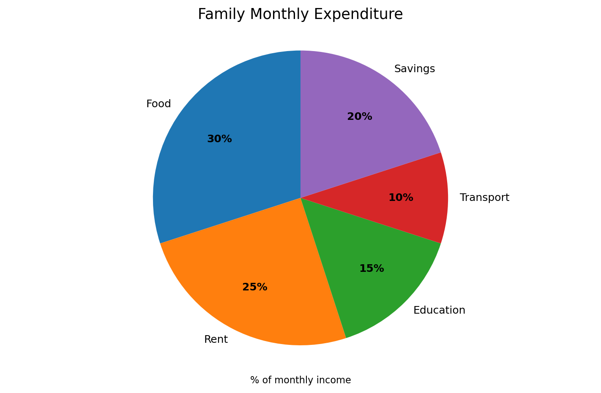
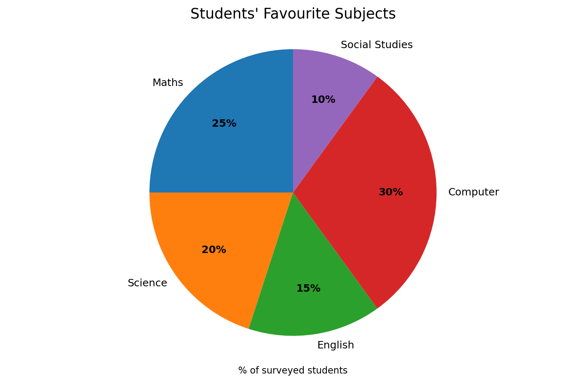
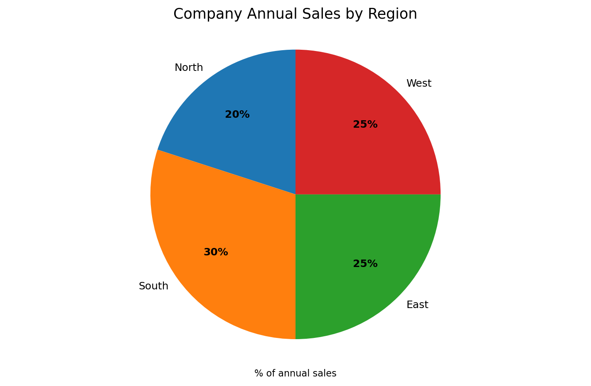
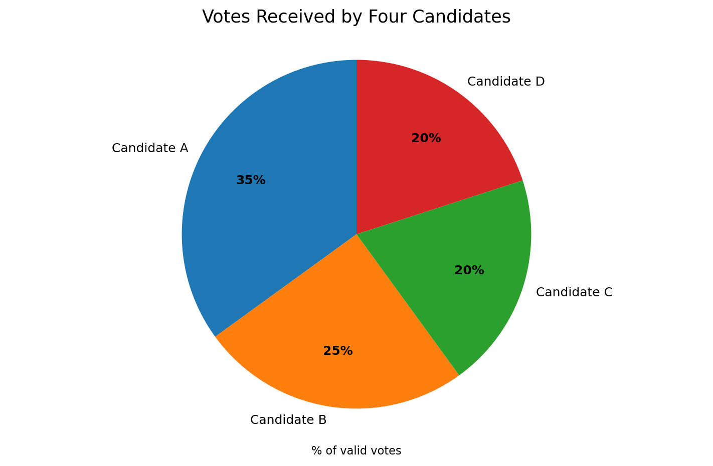
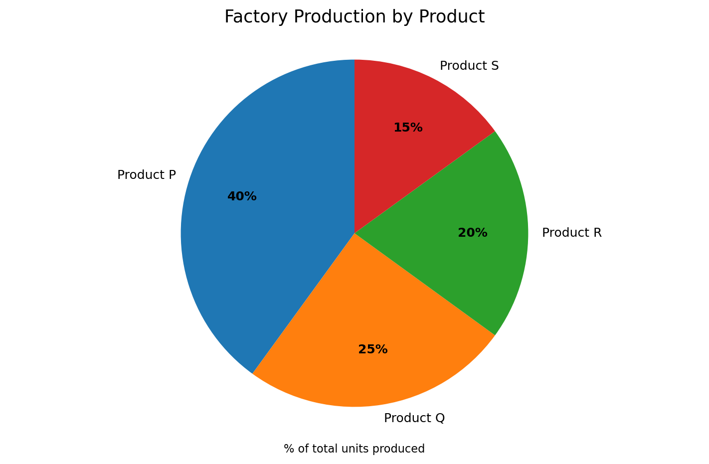

## Chart 1: Family Monthly Expenditure

**Q1.** What percentage of monthly income is spent on food?

A) 20%   B) 25%   C) 30%   D) 35%

**Q2.** Which category accounts for the second-largest share?

A) Rent   B) Savings   C) Education   D) Transport

**Q3.** If monthly income is ₹40,000, how much is spent on education?

A) ₹4,000   B) ₹5,000   C) ₹6,000   D) ₹8,000

**Q4.** What is the combined percentage spent on transport and education?

A) 20%   B) 25%   C) 30%   D) 35%

**Q5.** If rent is ₹10,000, what is the family's total monthly income?

A) ₹25,000   B) ₹35,000   C) ₹40,000   D) ₹50,000

**Q6.** The family reduces food spending by 10% of its current food budget. What percentage of the original total income does it save?

A) 2%   B) 3%   C) 5%   D) 10%

## Chart 2: Students' Favourite Subjects

**Q7.** Which subject is preferred by the largest percentage of students?

A) Maths   B) Science   C) Computer   D) English

**Q8.** What percentage of students prefer English?

A) 10%   B) 15%   C) 20%   D) 25%

**Q9.** If 200 students were surveyed, how many prefer Maths?

A) 25   B) 40   C) 50   D) 60

**Q10.** What is the difference between the percentages preferring Computer and Science?

A) 5 percentage points   B) 10 percentage points   C) 15 percentage points   D) 20 percentage points

**Q11.** If 60 students prefer English, how many students were surveyed in total?

A) 300   B) 360   C) 400   D) 600

**Q12.** If 20 students who prefer Social Studies switch to Computer, and the total surveyed remains 400, what percentage then prefers Computer?

A) 30%   B) 32.5%   C) 35%   D) 37.5%

## Chart 3: Company Annual Sales by Region

**Q13.** Which region contributes the highest share of annual sales?

A) North   B) South   C) East   D) West

**Q14.** What percentage of sales comes from the East and West regions combined?

A) 40%   B) 45%   C) 50%   D) 55%

**Q15.** If annual sales are ₹8 crore, what are sales from the North region?

A) ₹1.2 crore   B) ₹1.6 crore   C) ₹2 crore   D) ₹2.4 crore

**Q16.** By how many percentage points does South exceed North?

A) 5   B) 10   C) 15   D) 20

**Q17.** If East-region sales equal ₹5 crore, what are total annual sales?

A) ₹15 crore   B) ₹18 crore   C) ₹20 crore   D) ₹25 crore

**Q18.** Next year, North sales increase by 50% while total company sales stay the same. If North's share rises from 20% to 30%, by how many percentage points must the combined share of the other regions fall?

A) 5   B) 8   C) 10   D) 15

## Chart 4: Votes Received by Four Candidates

**Q19.** Which candidate received the highest percentage of valid votes?

A) A   B) B   C) C   D) D

**Q20.** What percentage of valid votes did Candidate B receive?

A) 20%   B) 25%   C) 30%   D) 35%

**Q21.** If there were 2,000 valid votes, how many votes did Candidate C receive?

A) 200   B) 300   C) 400   D) 500

**Q22.** Candidates C and D together received how many votes if the total was 3,500?

A) 700   B) 1,050   C) 1,400   D) 1,750

**Q23.** If Candidate A received 700 votes, how many valid votes were cast?

A) 1,400   B) 1,750   C) 2,000   D) 2,500

**Q24.** If 100 votes are declared invalid and the pie chart percentages were based on valid votes only, can the total number of votes cast be found from the chart alone?

A) Yes, exactly   B) Yes, if Candidate A's votes are known   C) No, not without another quantity   D) Only if Candidate B and C are equal

## Chart 5: Factory Production by Product

**Q25.** What percentage of units are Product P?

A) 15%   B) 20%   C) 25%   D) 40%

**Q26.** Which product has the smallest share of production?

A) P   B) Q   C) R   D) S

**Q27.** If 600 units are produced, how many are Product Q?

A) 100   B) 120   C) 150   D) 240

**Q28.** Products P and R together account for what fraction of production?

A) 1/2   B) 3/5   C) 2/3   D) 3/4

**Q29.** If Product S accounts for 90 units, how many total units were produced?

A) 450   B) 500   C) 600   D) 750

**Q30.** Production of Product P falls by 25% of its current quantity while the other products' quantities remain unchanged. If the original total was 1,000 units, what is the new total production?

A) 850   B) 900   C) 925   D) 950

## Answer Key with Explanations

- **Q1: C)** 
- **Q2: A)** 
- **Q3: C)** 
- **Q4: B)** 
- **Q5: C)** 
- **Q6: B)** 
- **Q7: C)** 
- **Q8: B)** 
- **Q9: C)** 
- **Q10: B)** 
- **Q11: C)** 
- **Q12: C)** 
- **Q13: B)** 
- **Q14: C)** 
- **Q15: B)** 
- **Q16: B)**
- **Q17: C)** 
- **Q18: C)** 
- **Q19: A)** 
- **Q20: B)** 
- **Q21: 20% of 2,000 = 400 votes.)** 
- **Q22: C)** 
- **Q23: C)** 
- **Q24: C)** 
- **Q25: D)** 
- **Q26: D)** 
- **Q27: C)** 
- **Q28: B)**
- **Q29: C)** 
- **Q30: B)** 

---
